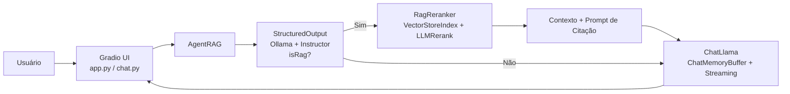

<div align="center">
  
</div>

<p align="center">
  
  
  
  
  
  
</p>

---

## 📖 Sobre o Projeto

O **LLama-Rag-Reranker** implementa um pipeline de **Retrieval-Augmented Generation (RAG) com Reranking** sobre o **LlamaIndex**, combinado com um agente conversacional (`AgentRAG`) que decide automaticamente quando buscar contexto externo em documentos antes de responder.

O projeto combina modelos locais via **Hugging Face** e **Ollama** (com saída estruturada via **Instructor + Pydantic**), memória de conversa e streaming de respostas em uma interface web construída com **Gradio**.

---

## ✨ Funcionalidades

- 🔍 **Recuperação vetorial + Reranking (`RagReranker`):** indexa documentos locais com `VectorStoreIndex`, recupera candidatos via `VectorIndexRetriever` e refina a relevância com `LLMRerank` e validação estruturada.
- 🧠 **Roteamento inteligente (`AgentRAG`):** classifica automaticamente se a pergunta precisa de consulta à base de documentos (`isRag`) ou se pode ser respondida diretamente pelo modelo.
- 📐 **Saída estruturada (`StructuredOutput`):** integração com `instructor` + `Pydantic` rodando sobre a API local do **Ollama** (`llama3.2:3b-instruct-fp16`).
- 💬 **Memória conversacional com streaming (`ChatLlama`):** mantém histórico de contexto via `ChatMemoryBuffer` e transmite a resposta token a token.
- 🖥️ **Interface Web pronta (`app.py` / `chat.py`):** chat interativo em **Gradio** com suporte a arquivos `.jsonl` via `JSONReader`.

---

## 🏗️ Arquitetura



---

## 📂 Estrutura do Repositório

```text
LLama-Rag-Reranker/
├── app.py                        # Interface Gradio com JSONReader (.jsonl) e bfloat16 em CUDA
├── chat.py                       # Interface Gradio padrão com documentos em docs/
├── llama_rag_reranker/
│   ├── __init__.py
│   ├── AgentRag.py               # Orquestrador com roteamento RAG vs chat direto
│   ├── RagReranker.py            # Indexação vetorial, busca e reranking de documentos
│   ├── ChatLlama.py              # Gerenciamento de histórico e streaming de respostas
│   └── StructuredOutput.py       # Chamadas estruturadas (JSON/Pydantic) via Instructor + Ollama
├── utils/
│   ├── templates.py              # Templates de prompt (relevância, roteamento e citação)
│   └── utils.py                  # Helpers de validação de kwargs
├── requirements.txt
└── LICENSE
```

---

## 📋 Pré-requisitos

- **Python** `3.10.0` (versão testada)
- **CUDA** `11.8` (para aceleração em GPU com PyTorch)
- **Ollama** instalado e rodando localmente em `http://localhost:11434`, com o modelo configurado:
  ```bash
  ollama pull llama3.2:3b-instruct-fp16
  ```

---

## ⚙️ Instalação

1. **Clone o repositório:**
   ```bash
   git clone https://github.com/charles-gabriel-cc/LLama-Rag-Reranker.git
   cd LLama-Rag-Reranker
   ```

2. **Crie e ative um ambiente virtual (recomendado):**
   ```bash
   python -m venv .venv
   # Windows (PowerShell)
   .venv\Scripts\Activate.ps1
   # Linux/macOS
   source .venv/bin/activate
   ```

3. **Instale as dependências:**
   ```bash
   pip install -r requirements.txt
   ```

4. **Instale o PyTorch com suporte a CUDA 11.8:**
   ```bash
   pip install torch torchvision torchaudio --index-url https://download.pytorch.org/whl/cu118
   ```

---

## 🚀 Como Usar

### 1. Rodando a Interface Web (Gradio)

Coloque seus documentos na pasta `docs/` na raiz do projeto e execute:

```bash
# Versão padrão (documentos em docs/)
python chat.py

# Versão com suporte a arquivos .jsonl (JSONReader)
python app.py
```

### 2. Usando `RagReranker` via Python

Configure os modelos padrão do LlamaIndex em `Settings` e instancie `RagReranker`:

```python
from llama_index.core import Settings
from llama_index.embeddings.huggingface import HuggingFaceEmbedding
from llama_index.llms.huggingface import HuggingFaceLLM
from llama_rag_reranker import RagReranker

Settings.embed_model = HuggingFaceEmbedding(
    model_name="all-MiniLM-L6-v2"
)

Settings.llm = HuggingFaceLLM(
    model_name="meta-llama/Llama-3.2-3B-Instruct",
    tokenizer_name="meta-llama/Llama-3.2-3B-Instruct",
)

# Inicializa o pipeline apontando para a pasta de documentos
reranker = RagReranker(data_dir="docs")

# Recupera e reordena os trechos mais relevantes
results = reranker.retrieve_documents("O que é Retrieval-Augmented Generation?")
```

### 3. Usando o Agente Conversacional (`AgentRAG`)

```python
from llama_rag_reranker import AgentRAG

agent = AgentRAG(data_dir="docs")

for chunk in agent.query("Resuma os pontos principais dos documentos."):
    print(chunk, end="", flush=True)
```

---

## 📄 Licença

Este projeto está sob a licença definida no arquivo [LICENSE](LICENSE).

---

<div align="center">
  <sub>Desenvolvido por <a href="https://github.com/charles-gabriel-cc">Charles Gabriel</a></sub>
</div>
