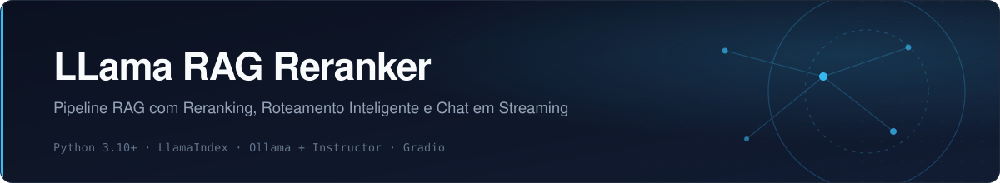
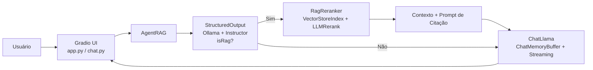

<p align="center">
  
</p>

<p align="left">
  
  
  
  
  
  
</p>

## Sobre o Projeto

O **LLama-Rag-Reranker** implementa um pipeline de **Retrieval-Augmented Generation (RAG) com Reranking** sobre o **LlamaIndex**, combinado com um agente conversacional (`AgentRAG`) que decide automaticamente quando consultar a base de documentos antes de responder.

O projeto integra modelos locais via **Hugging Face** e **Ollama** (saída estruturada com **Instructor + Pydantic**), memória de conversa e streaming de respostas em uma interface web construída com **Gradio**.

## Funcionalidades

- **Recuperação vetorial + Reranking (`RagReranker`):** indexa documentos locais com `VectorStoreIndex`, recupera candidatos via `VectorIndexRetriever` e refina a relevância com `LLMRerank` e validação estruturada.
- **Roteamento inteligente (`AgentRAG`):** classifica automaticamente se a pergunta exige busca em documentos (`isRag`) ou resposta direta do modelo.
- **Saída estruturada (`StructuredOutput`):** integração com `instructor` + `Pydantic` sobre a API local do **Ollama** (`llama3.2:3b-instruct-fp16`).
- **Memória conversacional com streaming (`ChatLlama`):** mantém histórico via `ChatMemoryBuffer` e transmite a resposta token a token.
- **Interface Web pronta (`app.py` / `chat.py`):** chat interativo em **Gradio** com suporte opcional a arquivos `.jsonl` via `JSONReader`.

## Arquitetura



## Estrutura do Repositório

```text
LLama-Rag-Reranker/
├── app.py                        # Interface Gradio com JSONReader (.jsonl) e bfloat16 em CUDA
├── chat.py                       # Interface Gradio padrão com documentos em docs/
├── llama_rag_reranker/
│   ├── __init__.py
│   ├── AgentRag.py               # Orquestrador com roteamento RAG vs chat direto
│   ├── RagReranker.py            # Indexação vetorial, busca e reranking de documentos
│   ├── ChatLlama.py              # Gerenciamento de histórico e streaming de respostas
│   └── StructuredOutput.py       # Chamadas estruturadas (JSON/Pydantic) via Instructor + Ollama
├── utils/
│   ├── templates.py              # Templates de prompt (relevância, roteamento e citação)
│   └── utils.py                  # Helpers de validação de kwargs
├── requirements.txt
└── LICENSE
```

## Pré-requisitos

- **Python** `3.10+` *(testado em `3.10.0`)*
- **GPU NVIDIA com CUDA `11.8`** *(recomendado para `Llama-3.2-3B-Instruct` em `bfloat16`/`float16`)*
- **Ollama** rodando localmente em `http://localhost:11434`, com o modelo baixado:
  ```bash
  ollama pull llama3.2:3b-instruct-fp16
  ```

## Instalação

```bash
git clone https://github.com/charles-gabriel-cc/LLama-Rag-Reranker.git
cd LLama-Rag-Reranker

python -m venv .venv
# Windows (PowerShell): .venv\Scripts\Activate.ps1
# Linux/macOS:         source .venv/bin/activate

# 1. Instale primeiro o PyTorch com suporte a CUDA 11.8
pip install torch torchvision torchaudio --index-url https://download.pytorch.org/whl/cu118

# 2. Instale as demais dependências
pip install -r requirements.txt
```

## Como Usar

### Interface Web (Gradio)

Coloque seus documentos na pasta `docs/` na raiz do projeto e execute:

```bash
# Versão padrão (documentos em docs/)
python chat.py

# Versão com suporte a arquivos .jsonl (JSONReader)
python app.py
```

### Uso Programático (`RagReranker` e `AgentRAG`)

```python
from llama_index.core import Settings
from llama_index.embeddings.huggingface import HuggingFaceEmbedding
from llama_index.llms.huggingface import HuggingFaceLLM
from llama_rag_reranker import RagReranker, AgentRAG

Settings.embed_model = HuggingFaceEmbedding(model_name="all-MiniLM-L6-v2")
Settings.llm = HuggingFaceLLM(
    model_name="meta-llama/Llama-3.2-3B-Instruct",
    tokenizer_name="meta-llama/Llama-3.2-3B-Instruct",
)

# 1. Recuperação e reranking direto
reranker = RagReranker(data_dir="docs")
results = reranker.retrieve_documents("O que é Retrieval-Augmented Generation?")

# 2. Chat com roteamento automático e streaming
agent = AgentRAG(data_dir="docs")
for chunk in agent.query("Resuma os pontos principais dos documentos."):
    print(chunk, end="", flush=True)
```

## Licença

Distribuído sob a licença definida em [LICENSE](LICENSE).
